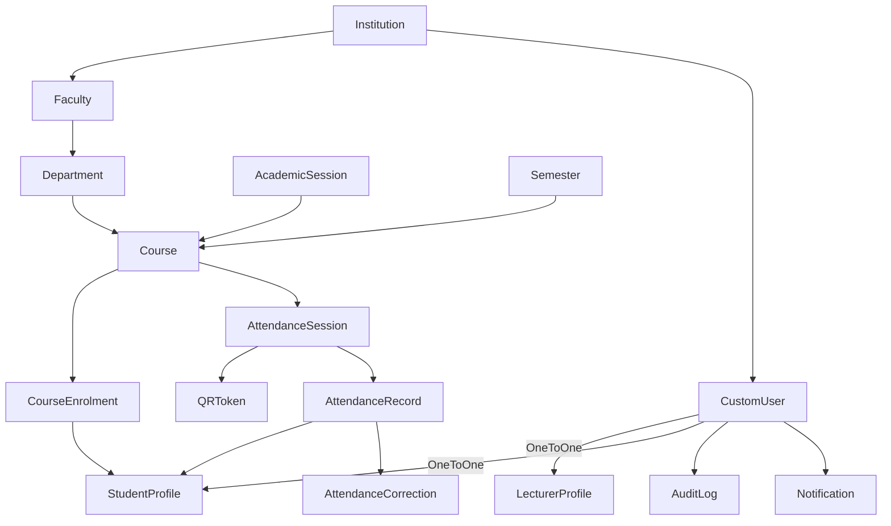

# Architecture and Implementation Roadmap

## 1. High‑level Overview

The **Lecturer Attendance Management System** (LAMS) is a multi‑tenant SaaS‑style Django application built with a clean, modular architecture.  It follows the *apps‑per‑domain* pattern so each major bounded context lives in its own Django app:

| App | Responsibility |
|-----|-----------------|
| `accounts` | Custom user model, authentication, role‑based permissions, password reset, email verification |
| `institutions` | Institution, faculty, department hierarchy, tenant isolation |
| `academics` | Academic sessions, semesters |
| `courses` | Course definition, enrolments, class‑list imports |
| `attendance` | Attendance sessions, QR token generation, live monitoring, attendance records |
| `imports` | File upload, PDF/Docx/Excel parsing, column‑mapping UI, preview & transactional import |
| `reports` | PDF/Excel report generation, analytics, Chart.js data endpoints |
| `notifications` | In‑app notification model and optional email backend |
| `audit` | Audit log for security‑relevant actions |
| `frontend` | Base templates, static assets, Tailwind configuration, HTMX helpers |

All apps communicate through well‑defined service modules (e.g. `courses.services`, `attendance.services`).  Business logic lives **outside** of view functions to keep views thin and testable.

## 2. Database Design (PostgreSQL)

Key entities are modelled as follows (simplified diagram):

* **UUID primary keys** are used for all public‑facing models (Course, AttendanceSession, etc.).
* **Natural keys** (matriculation number) are enforced as a unique constraint on `StudentProfile` scoped to an institution.
* **Row‑Level Security (RLS)** policies are defined for tenant isolation – each query is automatically filtered by the current institution via a PostgreSQL session variable set by middleware.
* **Unique constraints** prevent duplicate attendance (`unique_together = ("session", "student")`).
* **Indexes** on foreign keys and frequent lookup fields (e.g. `session__token`, `student__matric_number`).

## 3. Authentication & Authorization

* **Custom User Model** (`AbstractBaseUser` & `PermissionsMixin`).
* **Roles** are stored as a `choices` field on the user model (`SUPERADMIN`, `DEPT_ADMIN`, `LECTURER`, `STUDENT`).
* **Django permissions** are mapped to these roles via groups created in a data migration.
* **Login flow** uses Django’s built‑in authentication views, extended with HTMX for seamless UX.
* **Password hashing** uses `ARGON2PasswordHasher` (configured in settings).
* **Rate limiting** on login is provided by `django‑axes` (optional, installed via `requirements.txt`).

## 4. File Import Pipeline

1. **Upload** – HTMX form posts to `/courses/<id>/upload/`.
2. **Parsing** – Service selects parser based on MIME type (`pdfplumber`, `python-docx`, `openpyxl`).
3. **Column Mapping** – If headers cannot be auto‑matched, a dynamic mapping UI is rendered (HTMX).  The lecturer can adjust column ↔︎ field mapping.
4. **Preview** – Tabular preview with validation status (duplicate, missing, malformed).
5. **Confirmation** – On confirm, the import runs inside a single transaction; on any error the whole import is rolled back.
6. **Audit** – Import actions are logged in `AuditLog`.

## 5. QR‑Code Attendance Flow

* When a lecturer creates an attendance session, the service generates a **cryptographically random 128‑bit token** (`secrets.token_urlsafe(22)`).
* The token is stored in a `QRToken` model with an expiry timestamp.
* QR image is generated on‑the‑fly using the `qrcode` library and served via a cached view.
* The same token is embedded in the *attendance link* (`/attendance/mark/<token>/`).
* Student visits the link (or scans QR) → if not logged in, they are prompted to log in → backend validates token, session status, enrollment, and uniqueness before creating an `AttendanceRecord`.
* Tokens are **single‑use per session**; after the session closes, all associated tokens are invalidated.

## 6. Live Monitoring (HTMX)

* Lecturer’s “Live Attendance” page polls the server every 5 seconds via an HTMX‑triggered endpoint that returns a fragment with the current attendance table.
* The endpoint returns JSON for Chart.js analytics (attendance % over time) and a rendered HTML table for the register.
* Actions (pause, resume, close) are POSTed via HTMX and update the UI without a full reload.

## 7. Reporting & Analytics

* **PDF** reports via ReportLab – templated, professional layout with institution branding.
* **Excel** exports via OpenPyXL – preserving column types and formulas.
* **Chart.js** data endpoints (`/api/charts/attendance/…`) deliver JSON for dashboards.
* All reports respect role‑based access; students can only view their own reports.

## 8. Security Measures

* **CSRF** – Django’s middleware (HTMX automatically includes the token).
* **X‑Content‑Type‑Options**, **Referrer‑Policy**, **Strict‑Transport‑Security**, **Content‑Security‑Policy** headers via `django‑csp` (optional) and `whitenoise`.
* **File validation** – MIME type checking, size limits (10 MiB), storage in a non‑executed `media/` directory.
* **AuditLog** – records user, action, timestamp, IP, and object IDs for all sensitive operations.
* **HTTPS** – enforced via `SECURE_SSL_REDIRECT` in production settings.
* **RLS** – ensures no cross‑institution data leakage.

## 9. Development Roadmap (Phase‑by‑Phase)

| Phase | Goal | Deliverables |
|------|------|--------------|
| **0** | Project scaffolding | Django project, `requirements.txt`, Docker files, CI pipeline skeleton |
| **1** | Core authentication & role model | `accounts` app, custom user, login/logout, registration, email verification |
| **2** | Institution hierarchy | `institutions` app with models, admin, RLS middleware |
| **3** | Academic entities | `academics` app (sessions, semesters) and `courses` app (course CRUD, enrolments) |
| **4** | File import pipeline | `imports` app with parsers, preview UI, transactional import |
| **5** | Attendance engine | `attendance` app – session creation, QR generation, token validation, live monitoring |
| **6** | Reporting & analytics | `reports` app – PDF/Excel generation, Chart.js endpoints |
| **7** | Notification system | `notifications` app – in‑app toast notifications, optional email backend |
| **8** | Auditing & security hardening | `audit` app, RLS policies, security headers, rate‑limiting |
| **9** | Testing & CI | Comprehensive pytest suite, GitHub Actions workflow |
| **10**| Deployment docs | Docker‑Compose for local dev, Render/Railway production guide |

Each phase will be fully merged into `main` before moving to the next, with automated tests guaranteeing stability.

---

**Next step** (executed now): create the base Django project files (`config/settings.py`, `config/urls.py`, `config/asgi.py`, `config/wsgi.py`), install required apps, set up Tailwind via `django‑tailwind` (or simple PostCSS), and add a minimal base template with a responsive navigation bar.

All subsequent work will follow the roadmap.
